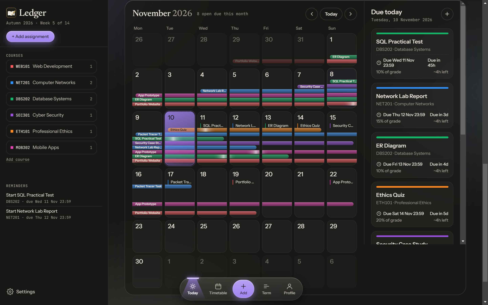
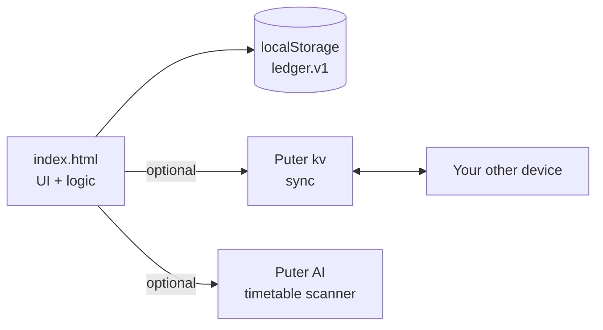

<div align="center">


# Ledger

**The assignment tracker that shows you what is due, what is running, and what to start today.**

[](index.html)
[](#-quick-start)
[](#-features)
[](#-sync-across-devices)

[Features](#-features) · [Quick start](#-quick-start) · [Usage](#-usage) · [How it works](#-how-it-works) · [Contributing](#-contributing)

<br>



</div>

<br>

## ✨ Overview

Deadlines hide in the gaps between courses. **Ledger** puts every assignment on one calendar, draws a bar from the day you start to the day it is due, and lists everything running through any day you tap.

It is a single `index.html`. There is no build step, no backend and no account needed. Your data stays in your browser, and an optional free [Puter](https://puter.com) sign-in syncs it between your PC and phone.

## 🚀 Features

| | |
|---|---|
| 📅 **Smart calendar** | One bar per assignment, straight from start to deadline in its own lane. A soft glint travels along each bar. |
| 📋 **Due list on tap** | Tap any day to see every assignment due or running through it. On phones it opens as a bottom sheet. |
| 🎨 **Course colours** | Ten bright presets, or press **Custom** for a colour wheel and hex input. |
| 🗓️ **Timetable** | A weekly class grid. Scan a timetable image and courses are created for you. |
| ⚡ **Quick add** | Type "report due friday 5pm" and the date, course and time are parsed. |
| 📊 **Grade aware** | Course weightings, a grade calculator, and crunch-week warnings. |
| 🔄 **Cross-device sync** | PC and phone stay in step through `puter.kv`. |
| ✅ **Safe submit** | A confirm prompt stops a mis-tap from marking a task done. |
| 🌗 **Light and dark** | Follows your system theme. Touch-friendly settings and locked zoom on mobile. |

## ⚡ Quick start

```bash
git clone https://github.com/Danialbroz/Assignment-Tracker.git
cd Assignment-Tracker
```

Open `index.html` in a browser, or serve it:

```bash
python -m http.server 8000   # then visit http://localhost:8000
```

**Requirements:** a modern browser. Python 3 is optional and only used to serve the file.

## 🧭 Usage

1. **Add courses** from the left rail, or scan your timetable.
2. **Add an assignment** with **+ Add assignment**. Set a start date and a due date.
3. **Plan from the calendar.** Bars show what overlaps. Tap a day for its Due list.
4. **Tick it off** when done and confirm the prompt.

> 📱 **On a phone:** use your browser's **Add to Home Screen** to install Ledger like an app.

### 🔄 Sync across devices

Open the settings gear, sign in to Puter on each device, and your data follows you. The newest change wins.

## 🛠️ How it works



| Piece | Detail |
|---|---|
| **Storage** | State lives in `localStorage` under `ledger.v1` and is saved on every change. |
| **Sync** | Writes are debounced by 1 s and pushed with `puter.kv`. The pull on load keeps whichever side has the newer `updatedAt`. |
| **Calendar** | Each assignment gets a stable lane, so its bar stays straight through every week. The glint phase follows the page clock, so re-renders never restart it. |
| **Config** | There are no environment variables. Settings (semester start, theme, sign-in) live in the settings menu. |

<details>
<summary><b>📁 Project structure</b></summary>

<br>

| File | Purpose |
|---|---|
| `index.html` | The whole app: markup, styles and logic |
| `logo.svg`, `apple-touch-icon.png` | Icons |
| `docs/` | README screenshots |
| `graphify-out/` | Generated code knowledge graph (optional) |

</details>

## 🤝 Contributing

Contributions are welcome.

1. Fork the repo and branch: `git checkout -b feature/my-change`.
2. Keep the app in a single file with no build tooling.
3. Test on desktop and a phone-sized viewport, in light and dark themes.
4. Open a pull request that says what changed and why.

## 📄 License

No license has been chosen yet. Add a `LICENSE` file (for example MIT) before others reuse the code.

<div align="center">
<br>

Built for students who would rather see the deadline coming. ⭐ Star the repo if it helps you.

</div>
